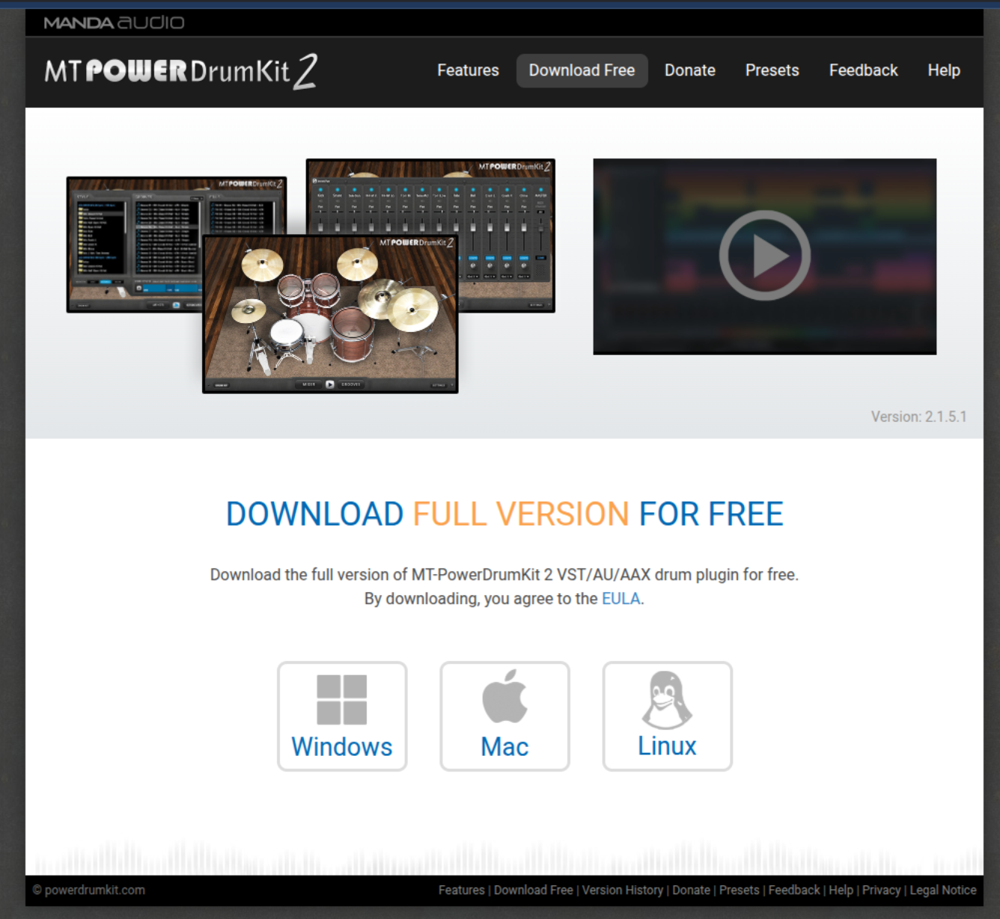
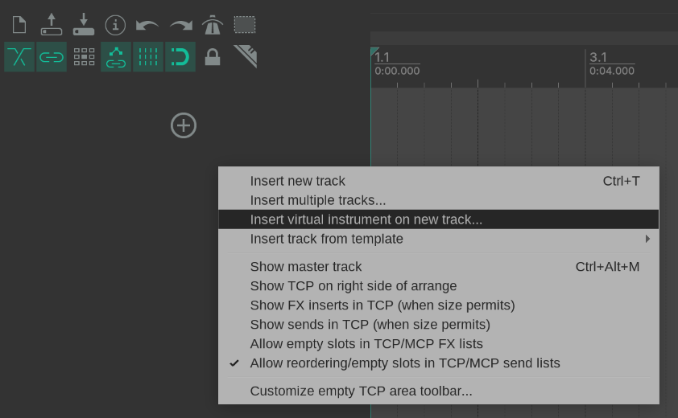
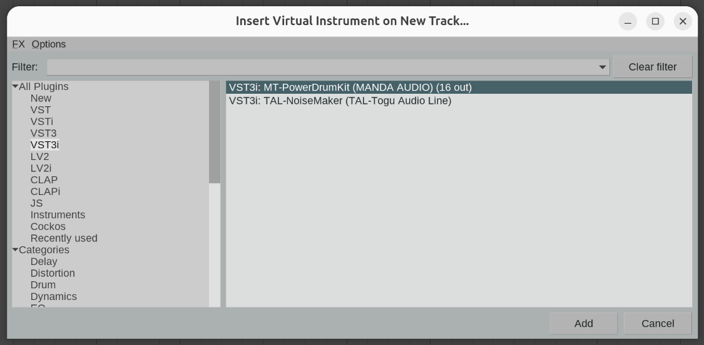
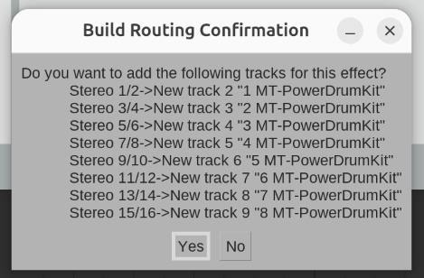

# :notes: MT Power Drum Kit en Reaper

Esta guía recopila los pasos para descargar, instalar, configurar y programar ritmos de batería MIDI utilizando el plugin gratuito **MT Power Drum Kit 2** dentro de **Reaper**.

---

## Parte 1: Instalación y Configuración del Plugin

### Paso 1: Descargar el plugin

1. Entra a la página oficial de [MT Power Drum Kit](https://www.powerdrumkit.com/).

2. Dirígete a la sección de descargas y selecciona el archivo correspondiente a tu sistema operativo (**Windows**, **Mac** o **Linux**).

3. Descarga el archivo comprimido (ZIP) y descomprímelo en una ubicación accesible de tu computadora.

### Paso 2: Colocar los archivos en la carpeta de VSTs

Dependiendo de tu sistema operativo, debes mover los archivos del plugin (`.dll`, `.vst3` o componente según corresponda) a la ruta donde Reaper lee tus instrumentos virtuales:

* **En Windows (VST2):** Copia los archivos `MT-PowerDrumKit.dll` y `MT-PowerDrumKit-Content.pdk` y pégalos dentro de tu carpeta de plugins VST predeterminada (por lo general en `C:\Program Files\VstPlugins` o `C:\Steinberg\VSTPlugins`).

* **En Windows (VST3):** Asegúrate de que el archivo `.vst3` se encuentre en `C:\Program Files\Common\VST3`.

* **En Mac:** Coloca el archivo en la ruta correspondiente de librerías VST/VST3/AU (`Library/Audio/Plug-Ins/VST/...`).

* **En Linux** Sigue las instrucciones de los archivos `INSTALL on [Distro].txt`) según la distribución. Básicamente se trata de colocar el folder completo `MT-PowerDrumKit.vst3` dentro de `$HOME/.vst3`.

### Paso 3: Escanear el plugin en Reaper

1. Abre **Reaper**.

2. Ve al menú superior y selecciona **Options** (Opciones) > **Preferences** (Preferencias) (o presiona `Ctrl + P` en Windows / `Cmd + P` en Mac).

3. En el panel izquierdo, busca la sección **Plugins** y haz clic en **VST**.

4. En el campo de rutas de carpetas VST (*VST plugin paths*), verifica que esté agregada la carpeta donde colocaste el archivo del plugin. Si no está, haz clic en **Add...** (Añadir) y selecciónala.

5. Haz clic en el botón **Clear cache and re-scan** (Borrar caché y volver a escanear) para que Reaper detecte el nuevo instrumento.

### Paso 4: Cargar el plugin en un proyecto

1. Crea una nueva pista en Reaper haciendo doble clic en el espacio gris del panel de pistas o presionando `Ctrl + T` (`Cmd + T` en Mac).

2. Haz clic en el botón **FX** de la pista para abrir el explorador de efectos.

3. En la barra de búsqueda, escribe `MT PowerDrumKit`.

4. Selecciónalo (aparecerá como VST, VST3 o AU) y haz clic en **Add** (Añadir).

> Al añadir instrumento no es necesario agregar todos los canales de ruta, así es que elige **NO** y solo trabaja en un canal.

### Paso 5: Activar el sonido del plugin (Versión Gratuita)

> **Nota:** La versión gratuita de MT Power Drum Kit muestra una pantalla de donación al iniciar y **no emitirá sonido** hasta que hagas clic en el botón de activación de la sesión.

1. Abre la interfaz gráfica del plugin en Reaper haciendo doble clic sobre él en el rack de efectos (**FX**).

2. En la esquina inferior derecha de la ventana del plugin, haz clic en el botón **START** para habilitar el sonido y saltar el aviso de donación. ¡Listo, ya podrás empezar a usar los grooves y la batería en tu proyecto!

---

## Parte 2: Programación y Edición de Batería MIDI en Reaper

Existen dos formas principales de trabajar con este plugin: aprovechando su biblioteca interna de ritmos (*Grooves*) o escribiendo tus propios patrones desde cero en el editor MIDI.

### Método 1: Arrastrar ritmos desde la librería de MT Power Drum Kit

El plugin incluye cientos de patrones y redobles listos para usar:

1. Abre la interfaz de **MT Power Drum Kit 2** desde el botón **FX** de tu pista.

2. Haz clic en la pestaña **GROOVES** ubicada en la parte superior de la ventana del plugin.

3. Selecciona un estilo musical en la columna izquierda (por ejemplo, *Rock*, *Pop*, *Metal*) y un ritmo en la columna central. Haz clic sobre él para escucharlo.

4. Para llevarlo a tu proyecto, **haz clic y arrastra** el nombre del ritmo directamente desde la ventana del plugin hacia la línea de tiempo de tu pista en Reaper.

5. Repite el proceso agregando variaciones o redobles (*Fills*) uno al lado del otro para construir la estructura de tu canción.

---

### Método 2: Crear y editar un ítem MIDI desde cero

#### Paso 1: Insertar un ítem MIDI vacío

1. Selecciona la pista donde tienes cargado MT Power Drum Kit.

2. Haz clic y arrastra sobre la regla superior de la línea de tiempo para marcar el área donde quieres el ritmo (por ejemplo, del compás 1 al 5).

3. En el menú superior, ve a **Insert** > **New MIDI item**. Aparecerá un bloque vacío en tu pista.

#### Paso 2: Configurar el editor MIDI en modo batería

1. Haz **doble clic** sobre el ítem MIDI recién creado para abrir el editor (*Piano Roll*).

2. En el menú superior del editor MIDI, ve a **View** > **Piano roll notes** y selecciona **Triangles (drum mode)** (Triángulos / modo batería) o **Diamonds (drum mode)**. Esto facilita visualizar los golpes en lugar de notas largas.

3. Activa la rejilla (*Snap*) haciendo clic en el icono del imán en la barra de herramientas del editor y ajusta la división en la parte inferior derecha (por ejemplo, **1/8** o **1/16** para semicorcheas).

#### Paso 3: Ubicar los elementos del kit (Mapa MIDI)

MT Power Drum Kit sigue el estándar General MIDI (GM). Las notas principales son:

| Nota MIDI | Elemento de la Batería |
| :--- | :--- |
| **C1 (Do 1)** | Bombo (*Kick*) |
| **D1 (Re 1)** | Caja / Redoblante (*Snare*) |
| **F#1 (Fa# 1)** | Charles cerrado (*Closed Hi-Hat*) |
| **A#1 (La# 1)** | Charles abierto (*Open Hi-Hat*) |
| **C#2 (Do# 2)** | Platillo Crash 1 |
| **D#2 (Re# 2)** | Platillo Ride |
| **C2, A1, F1** | Toms (Agudo, Medio, Grave) |

#### Paso 4: Dibujar y humanizar el ritmo

1. **Dibujar golpes:** Haz doble clic (o clic y arrastrar según tu configuración) en la intersección de la nota y el tiempo deseado.

2. **Borrar golpes:** Haz doble clic sobre un triángulo existente o selecciónalo y presiona `Supr` (`Delete`).

3. **Ajustar la intensidad (Velocity):** En la parte inferior del editor MIDI verás unas barras verticales. Arrastra hacia arriba o abajo la barra correspondiente a cada golpe para hacerlo sonar más fuerte o más suave (fundamental para que el *Hi-Hat* y los redobles suenen realistas y no robóticos).

4. **Duplicar el loop:** Cierra el editor MIDI, coloca el cursor en el borde derecho del ítem MIDI en la pista principal y arrástralo hacia la derecha para repetir el patrón automáticamente.

> **Consejo rápido:** Si editaste un ritmo arrastrado desde el plugin y quieres guardar tu versión modificada, haz clic derecho sobre el ítem MIDI y selecciona **Glue items** para consolidar las ediciones en un nuevo bloque limpio.