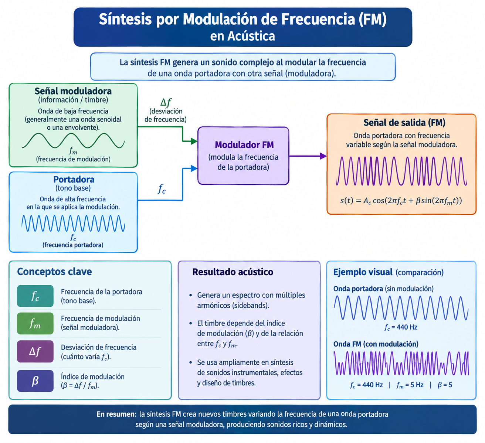
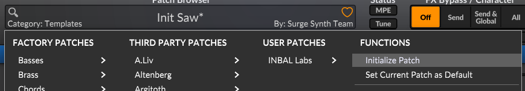
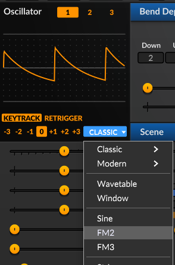
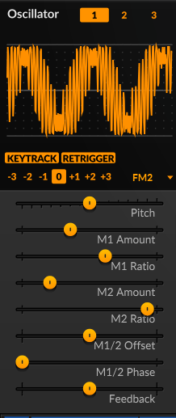
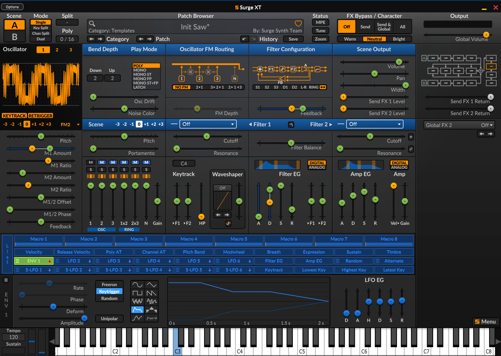

# Guía de Síntesis FM en Surge XT

## 1. Introducción a la Síntesis FM en Surge XT

Crear **Síntesis FM (Modulación de Frecuencia)** en Surge XT es sumamente sencillo, ya que incluye algoritmos dedicados que convierten a cada oscilador en un motor FM independiente.

### Pasos iniciales activos para modelar un sonido FM desde cero:

* **Inicializar el parche:** Haz clic derecho en el navegador de parches (en la barra superior) y selecciona **Refresh / Initialize patch** para comenzar con un sonido limpio de onda de sierra.

* **Cambiar al modo FM:** Dirígete a la sección del **Oscilador 1** (los controles superiores en color rojo). Haz clic en el menú desplegable del tipo de oscilador (por defecto dice *Classic*) y selecciona **FM2** o **FM3**. Elige **FM2** para empezar (un operador portador y dos moduladores independientes).

* **Configurar los Moduladores (Ratios):** Los deslizadores **M1 Ratio** y **M2 Ratio** determinan la relación armónica con el portador. Configura **M1 Ratio en 2.000** o **3.000** para obtener armónicos limpios y musicales.
* **Inyectar la Modulación (Amount):** Sube gradualmente el deslizador **M1 Amount**. Notarás cómo la onda senoidal pura gana brillo y complejidad metálica.

* **Darle movimiento con Envolventes:** Selecciona una de las envolventes disponibles (como **Env LFO 1** en modo envolvente), haz clic en el botón de la fuente de modulación, ve al deslizador **M1 Amount** y arrástralo hacia arriba. Ajusta un *Ataque* rápido y un *Decay* corto para lograr el clásico golpe percusivo FM.

* **Añadir Feedback y Carácter (Opcional):** Sube levemente el control de **Feedback** para que el operador se module a sí mismo, añadiendo distorsión armónica o ruido blanco.

---

## 2. Creación de Tres Sonidos Clásicos Paso a Paso

### A. Bajo FM Percusivo (Estilo *Donately* / House de los 90)
* **Oscilador:** Inicializa el parche. En el Oscilador 1, selecciona el modo **FM2**.
* **Ratios:** Configura **M1 Ratio en 2.000** y **M2 Ratio en 1.000**.
* **Cantidades:** Pon **M1 Amount en 0** (el sonido base debe ser una onda senoidal pura y grave).
* **Envolvente de Amplitud:** En **AMP ENV** ajusta un **Attack de 0ms**, un **Decay corto (300-400ms)**, **Sustain en 0** y **Release corto (50ms)**.
* **Modulación:** Selecciona **FEG** o **Env LFO 1** en modo *Envelope* con **Attack en 0ms y Decay corto (200ms)**. Activa la modulación y sube **M1 Amount un 40-50%**.

### B. Campanas Cristalinas (Estilo DX7)
* **Oscilador:** Inicializa el parche. En el Oscilador 1, selecciona el modo **FM2**.
* **Ratios:** Configura **M1 Ratio en 5.000 o 7.000** y **M2 Ratio en 1.000**.
* **Afinación sutil:** Sube el control **Detune** apenas un toque (0.02 - 0.05) para crear una inarmonía natural.
* **Envolvente de Amplitud:** Configura **AMP ENV** con **Attack en 0ms**, un **Decay largo (1.5 a 2.0 segundos)**, **Sustain en 0** y un **Release largo (1.0 segundo)**.
* **Modulación del brillo:** En la envolvente de modulación, pon **Attack en 0ms** y un **Decay medio (800ms)**. Asigna modulación positiva a **M1 Amount (30-40%)** y un toque leve a **M2 Amount**.
* **Efectos:** En la sección de FX añade un **Delay** y un **Reverb** amplio.

### C. Pad Atmosférico (Evolutivo y Espacial)
* **Oscilador:** Inicializa el parche. En el Oscilador 1, selecciona el modo **FM3** (tres moduladores).
* **Ratios:** Configura **M1 Ratio en 1.000**, **M2 Ratio en 2.000** y **M3 Ratio en 0.500**.
* **Envolvente de Amplitud:** Ajusta **AMP ENV** con **Attack largo (1.5 a 2.5 segundos)**, *Decay* largo, **Sustain alto (70-80%)** y **Release largo (1.5 segundos)**.
* **Modulación Evolutiva:** Selecciona **Env LFO 1** como LFO clásico (onda senoidal o triángulo). Baja su velocidad a un valor muy lento (0.10 Hz a 0.20 Hz). Asigna una modulación sutil (10-15%) a **M1 Amount** y **M2 Amount**.
* **Filtro y Efectos:** Activa el **Filtro 1** en modo *Lowpass 24dB* y cierra un poco el *Cutoff*. En la sección de FX, añade un efecto **Chorus** y una **Reverb** masiva con el *Decay* alto.