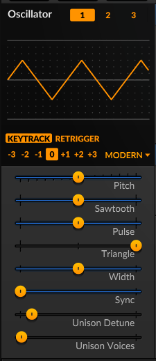
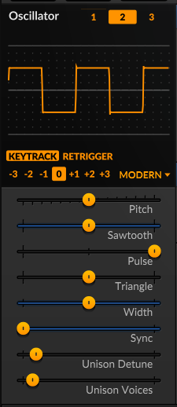
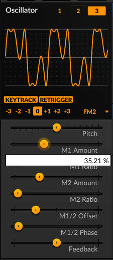
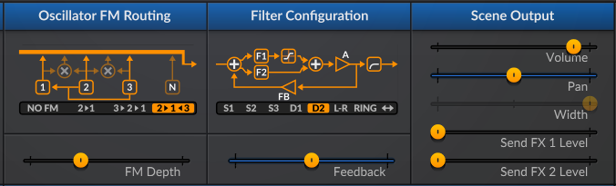
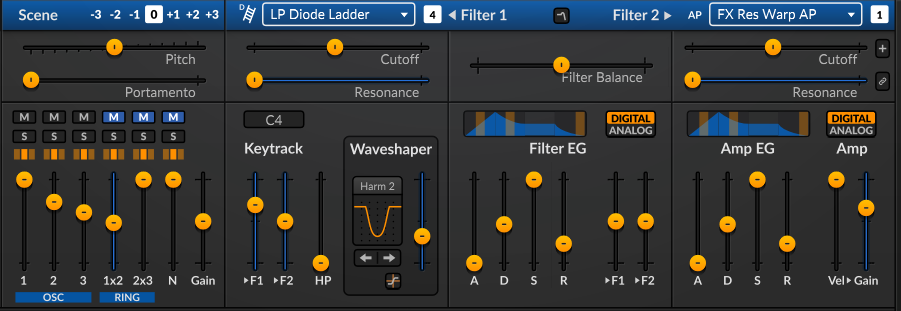
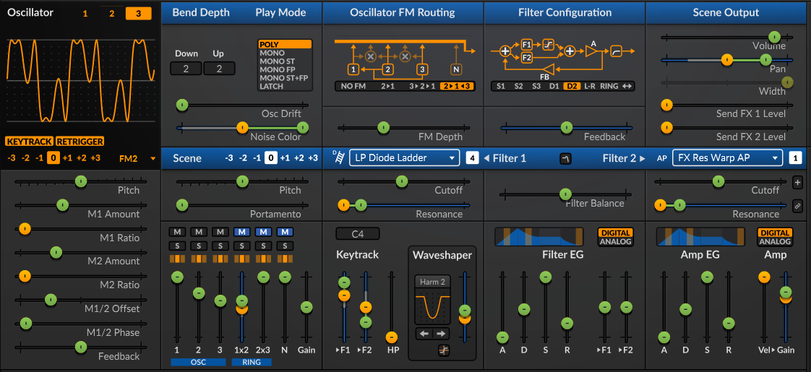
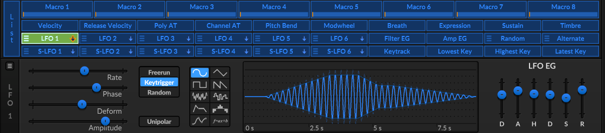
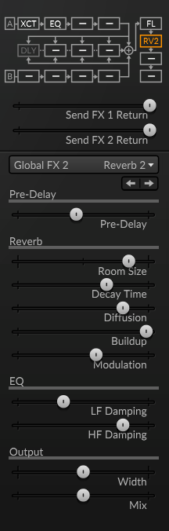

# :musical_keyboard: Crear un vibrato artificial con Frecuencia Modulada (FM) en SurgeXT

Para la siguiente práctica, solemante se trabajará con  el escenario A.

# Pasos

1. Abrir la aplicación Surge XT.

2. Configurar los osciladores de la siguiente manera:

| Oscilador | Parámetro | Valor |
| :--: | :-- | :-- |
| 1 | Tipo de Onda | Modern > Triangle (Triangular) | 
| 1 | Octava | 0 | 
| 1 | Pitch (altura) | 0 semitones (semitonos) | 
| 1 | Sawtooth (diente de sierra)  | 0 % | 
| 1 | Pulse (pulso) | 0 % | 
| 1 | Triangle (trángulo) | 100 % | 
| 1 | Width (ancho) | 50 % | 
| 1 | Sync (sincronización) | 0 semitones | 
| 1 | Unison Detune (desafinación de unísono) | 10 cents (centavos) | 
| 1 | Unison Voices (voces) | 1 voice (1 voz) | 

| Oscilador | Parámetro | Valor |
| :--: | :-- | :-- |
| 2 | Tipo de Onda | Modern > Square (Cuadrada) | 
| 2 | Octava | 0 | 
| 2 | Pitch (altura) | 0 semitones (semitonos) | 
| 2 | Sawtooth (diente de sierra)  | 0 % | 
| 2 | Pulse (pulso) | 100 % | 
| 2 | Triangle (trángulo) | 0 % | 
| 2 | Width (ancho) | 50 % | 
| 2 | Sync (sincronización) | 0 semitones | 
| 2 | Unison Detune (desafinación de unísono) | 10 cents (centavos) | 
| 2 | Unison Voices (voces) | 2 voice (2 voces) | 

| Oscilador | Parámetro | Valor |
| :--: | :-- | :-- |
| 3 | Tipo de Onda | FM2 (*frecuencia modulada para 3 operadores) | 
| 3 | Octava | 0 | 
| 3 | Pitch (altura) | 0 semitones (semitonos) | 
| 3 | M1 Amount (monto modulador 1)  | ~35% | 
| 3 | M1 Ratio | 2 | 
| 3 | M2 Amount | ~30% | 
| 3 | M2 Ratio | 2 | 
| 3 | M1/2 Offset | -5Hz |
| 3 | M1/2 Phase | 4% |
| 3 | FeedBack | 0% | 

> *FM2 (Modelo de 3 Operadores):* 
> - ***Estructura***: Consiste en **1 portadora** y **2 moduladores** que modulan la portadora de manera independiente (configuración paralela de moduladores).
> 
> - ***Proporciones (C:M ratios)***: Las proporciones entre la portadora y los moduladores están fijas en valores enteros.
> 
> - ***Carácter sonoro***: Gracias a las relaciones armónicas de números enteros, es un oscilador más limpio, musical y adecuado para melodías, acordes, bajos tradicionales y sonidos armónicos.

## Ruta de los osciladores y los algoritmos

3. Seleccionar **Oscillator FM Routing** en **`2 > 1 < 3`**. Establece **FM Depth** en `-24.00 dB`.

4. Establecer el algoritmo **Filter Configuration** en **D2**. **FeedBack** en `0%`.

5. Fija los valores del **Scene Output** al gusto.

## Filtros

6. Valores de **Scene**.

|Parámetro|Valor|
|--|--|
|Pitch| 0 semitones |
|Portamento| 0 ms |
| 1 |  0 dB |
| 2 | -8 dB |
| 3 | -14 dB |
| 1x2 | -20 dB |
| 2x3 | 0 dB |
| N | 0 dB |
| gain | 0 dB |

7. **Filter 1**

|Parámetro|Valor|
|--|--|
|Filter Type| Lowpass > Diode Ladder |
|Cutoff| ~523 Hz |
|Resonance| 0% |
| >F1 |  ~37% |
| >F2 | 0% |
| HP | ~7 Hz |
| Waveshaper Type | Harmonic > Soft Harmonic 2 |
| Waveshaper | ~-9 dB |

8. **Filter EG**

|Parámetro|Valor|
|--|--|
|Filter Balance| 0% |
|A|0 ms|
|D|250 ms|
|S|100%|
|R|~30ms|
| >F1 | 0 semitones |
| >F2 | 0 semitones |

9. **Filter 2**

|Parámetro|Valor|
|--|--|
|Filter Type| Effect > Resonance Warp Allpass |
|Cutoff| ~523 Hz |
|Resonance| 0% |

10. **Amp EG**

|Parámetro|Valor|
|--|--|
|A|0 ms|
|D|250 ms|
|S|100%|
|R|~30ms|
|Vel| 0 dB |
|Gain| ~15 dB |

## Modulación y ruteo

11. Seleccionar **LFO 1** como método de modulación. (ajustar los parámetros en verde, al gusto)

Parámetros de **LFO 1**

|Parámetro|Valor|
|--|--|
|Rate|4 Hz|
|Phase|~70%|
|Deform|~8%|
|Amplitude|~80%|

Parámetros de **LFO EG**

|Parámetro|Valor|
|--|--|
|D|~800 ms|
|A|~3s|
|H|~1s|
|D|~800 ms|
|S| ~50%|
|R| ~3.30 s|

## Efectos

13. **Scene A**.

|Parámetro|Valor|
|--|--|
|Efecto|Exciter > Init|
|Drive|86%|
|Tone|24%|
|Shape|5 ms|
|Attack|200 ms|
|Mix|30%|

- seleccionar efecto **EQ**.

14. **Global**

- Seleccionar efectos de **Flanger** y **Reverb**.

Parámetros al gusto.

