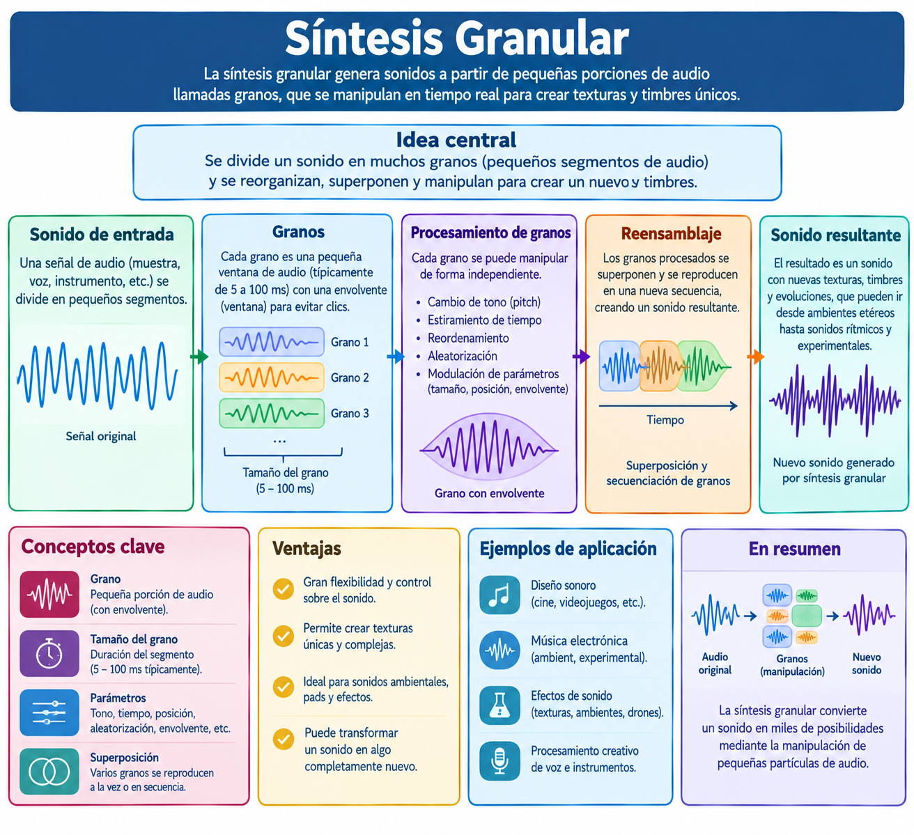
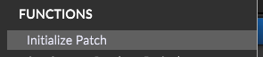
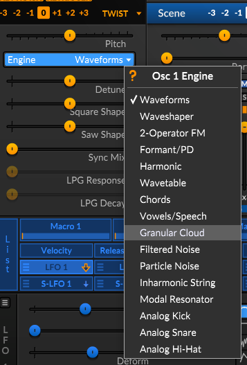
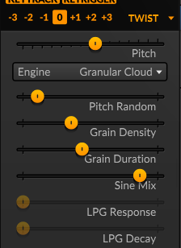
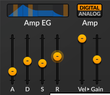
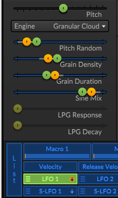
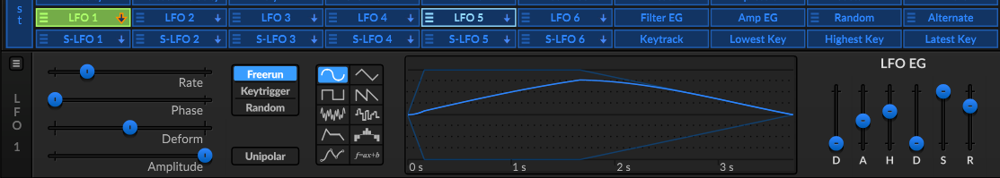
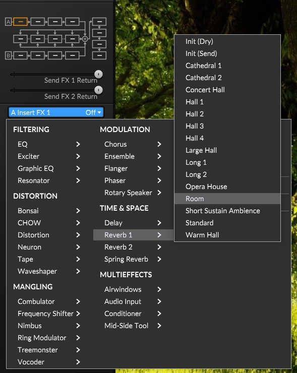

# :musical_keyboard: Síntesis Granular en Surge XT

## Métodos Principales

### 1. Oscilador Granular (Granular / Cloud)

Inspirado en módulos macro como *Clouds* de Mutable Instruments, este método genera sonido desde cero segmentando ondas o muestras.

* **Grain Density (Densidad de granos):** Controla cuántos fragmentos de audio se disparan por segundo.

* **Pitch / Spray:** Modula o desasigna la altura de los granos para generar nubes de sonido etéreas.

* **Size / Window:** Cambia la longitud o el tamaño de cada grano individual.

### 2. Efecto Granular (Nimbus) en FX\

Si prefieres procesar un sonido base externo o interno (como una onda de sierra o tablas de ondas):

* Ve a la pestaña **FX**.

* Importa el efecto **Nimbus** en uno de los bloques de la cadena para aplicar procesamiento granular en tiempo real.

---

## Diseño de un Pad Ambiental (Paso a Paso)

### Paso 1: Inicializar el Patch e Iniciar el Oscilador

* Haz clic derecho en la barra superior y selecciona **Init Patch**.

* En el menú desplegable del tipo de oscilador, cámbialo a **Cloud**.

    * Elige el `Osc 1`.
    * Tipo de onda `Twist`.
    * Abre el menú del parámetro `Engine` y selecciona `Granular Cloud`.

    

### Paso 2: Configurar los Controles del Oscilador Cloud

Ajusta los siguientes parámetros:

* **Pitch:** increméntalo a unos **30 - 50** semitonos para que el efecto se remarque.

* **Pitch Random:** ajústalo entre **5% - 10%** para añadir micro-variaciones de afinación orgánicas.

* **Grain Density:** súbelo al **35% - 45%** para que los granos se superpongan y creen una textura continua.

* **Grain Duration:** ajústalo al **40% - 50%** para un sonido fluido y menos percusivo.

* **Sine Mix:** súbelo entre **80% - 90%** para darle una sonido de onda sinoidal con textura granular.

### Paso 3: Moldear la Envolvente de Amplitud (Amp EG)

* **Attack:** Súbelo a **20.00s - 24.00s** para una entrada suave.

* **Sustain:** Manténlo del **30% - 40%**.

* **Release:** Súbelo a **500ms - 600ms** para que el sonido se 
desvanezca lentamente.

### Paso 4: Añadir Modulación Viva (LFO)

Para una exitación cíclica elije los siguientes parámetros.

1. Selecciona la pestaña **LFO 1**. (varios controles se activan en color verde)

    * **Pitch Random:** ajústalo entre **20% - 25%**.

    * **Grain Density:** súbelo al **40% - 50%**.

    * **Grain Duration:** ajústalo al **30% - 35%**.

    * **Sine Mix:** súbelo entre **70% - 76%**.

    

2. En la sección inferior de `LFO 1` Configura los siguientes parámetros.

    * **Rate:** ajústalo entre **0.085 Hz - 0.100 Hz**.

    * **A:** súbelo al **150 ms - 160 ms**.

    * **D:** bájalo a **0ms**.

    * **H:** ajústalo a **1s**.

    * **R:** confgúralo a **2s%**.

    

3. Haz clic en el botón **Mod** del parámetro **Position** (o *Texture*) y arrastra el valor hacia la derecha. La textura cambiará de forma orgánica automáticamente.

### Paso 5: Efectos Espaciales

* Ve a la pestaña **FX**.

* Inserta un efecto de **Reverb 1**, seleccionando la opción **Room**.

### Guarda el patch como `Granular`

---

## :book: Referencias Bibliográficas

- **Surge Synth Team**. (2026). *Surge XT User Manual*. GitHub Pages. [https://surge-synthesizer.github.io/manual-xt/](https://surge-synthesizer.github.io/manual-xt/)

- **Surge Synth Team**. (2021). *Nimbus - Mutable Instruments Clouds inspired granular effect* (Issue #3756). GitHub. [https://github.com/surge-synthesizer/surge/issues/3756](https://github.com/surge-synthesizer/surge/issues/3756)

- **Synth Anatomy**. (2021, 22 de abril). *Surge 1.9 Free Synth Plugin, 4 New OSC Types, New Effects (MI Clouds) & More*. [https://synthanatomy.com/2021/04/surge-1-9-free-synth-plugin-4-new-osc-types-new-effects-mi-clouds-more.html](https://synthanatomy.com/2021/04/surge-1-9-free-synth-plugin-4-new-osc-types-new-effects-mi-clouds-more.html)

- **VCV Library**. (2025). *Surge XT Window VCO*. [https://library.vcvrack.com/SurgeXTRack/SurgeXTOSCWindow](https://library.vcvrack.com/SurgeXTRack/SurgeXTOSCWindow)
