# :musical_keyboard: Síntesis por Tabla de Ondas en Surge XT

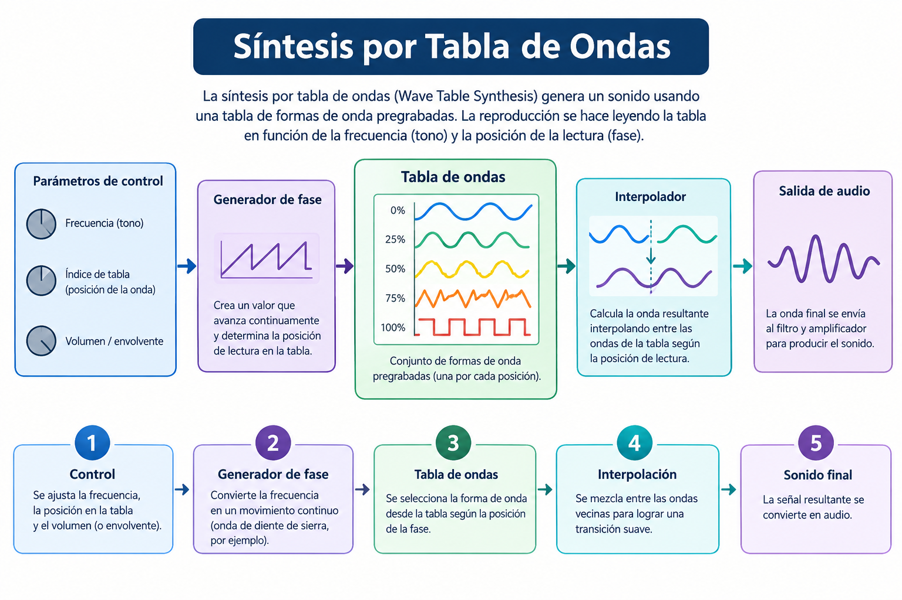

## 1. Configuración Básica del Oscilador (Wavetable)

* Selecciona uno de los osciladores activos (ej. **Oscillator 1**) en la sección roja de la interfaz.

* Cambia el tipo de motor de oscilación a **Wavetable** en el menú desplegable.

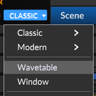

* Abre la librería interna haciendo clic en el visor y carga una tabla suave pero compleja (categorías **Basic > Triangles & Saws** o **Sampled > Vocal**).

|Triangles & Saws| Vocal|
|:--:|:--:|
|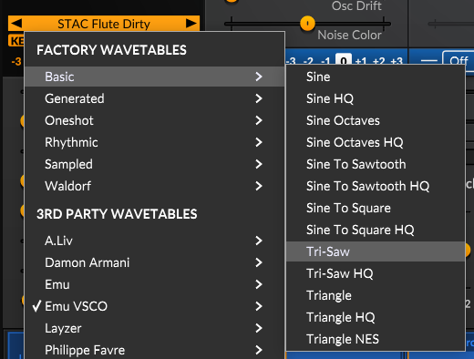|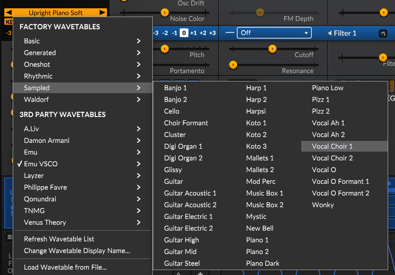|

* Utiliza los controles para configurar los siguientes parámetros:

|Parámetro| Rango |
|--|--|
|Pitch| **0** semitones|
|Morph| **50% <-> 70%**|
|Skew Vertical|**-15% <-> -30%**|
|Saturate| **20% <-> 30%** |
|Formant| **3 - 7** semitones|
|Skew Horizontal| **0%** |
|Unison detune| **7 - 10** cents|
|Unison voices| **2** voices|

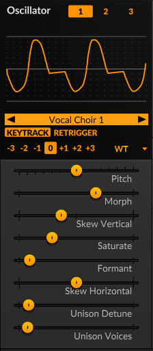

## 2. Creación del Cuerpo Cálido y Brillo Futurista (Dual Engine)

* **Oscilador 1 (Cuerpo cálido):** Usa tablas de onda de tipo *"Warm Saws"*, *"Vintage"* o *"Analog"*. Activa el **Unison** en **4 o 6 voces** con un detune moderado (10-20%) para ensanchar el estéreo.

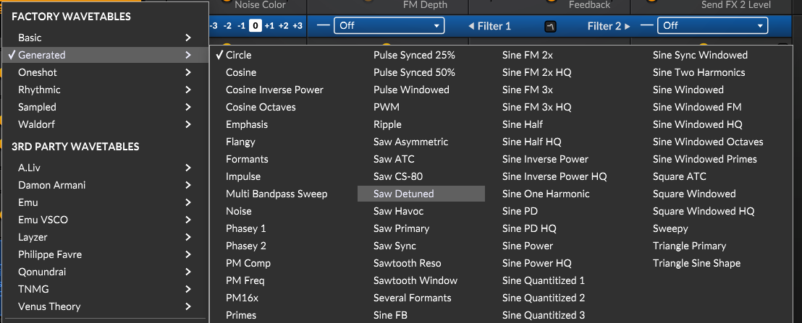

* **Oscilador 2 (Brillo futurista):** Enciende una segunda capa en modo **Wavetable** con categorías *"Formants"* o *"Spectral"*. Súbelo una octava completa (**+12 semitonos**) a un volumen más bajo de fondo.

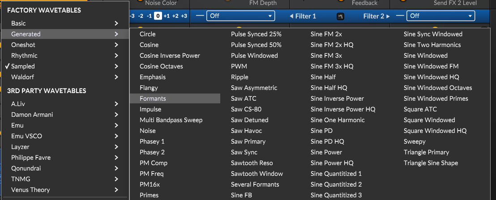

## 3. Modulación Lenta e Inestabilidad Orgánica

* **Para el movimiento futurista (LFO 1):** Utiliza una onda senoidal/triangular muy lenta configurada en frecuencia libre (**Hz en vez de Temposync, ej. 0.07 Hz**). Asígnala a la posición de tabla del Oscilador 2.

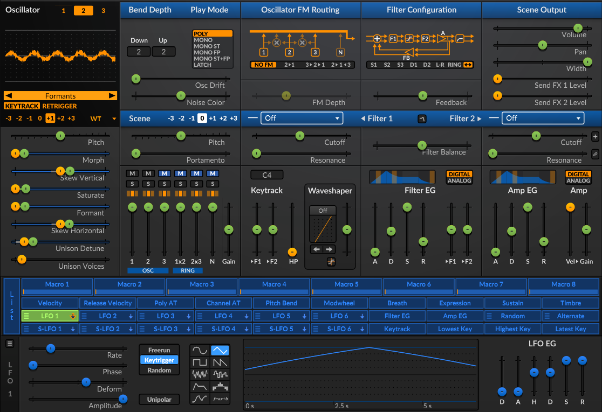

* **Para la calidez analógica (LFO 2):** Configura un LFO en modo **Noise / S&H** a velocidad extremadamente lenta (**ej. 0.11 Hz**). Aplícalo con una profundidad mínima (**0.5% - 1%**) al **Pitch** de ambos osciladores para simular el comportamiento errático de los circuitos vintage (*wow & flutter*).

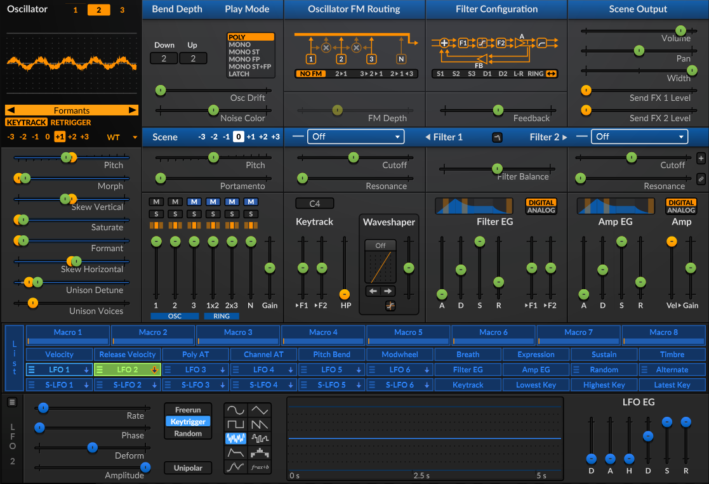

## 4. Envolventes y Filtrado Evolutivo Atmosférico

* **Ataque Infinito (AEG / FEG):** Para que las notas floten y no se note el golpe inicial, configura el **Attack** de la envolvente de amplitud (AEG) y de filtro (FEG) a valores largos entre **18.0 y 21.0 segundos**.

* **Filtro Clásico:** Selecciona los modelos analógicos virtuales **"Vintage Ladder"** o **"OB-Xd"** en modo **LP2 (Lowpass de 12dB)**. Deja pasar el aire futurista pero suaviza el tono general. Añade un toque de **Filter Balance** para dar grosor armónico del **8% - 10%**.

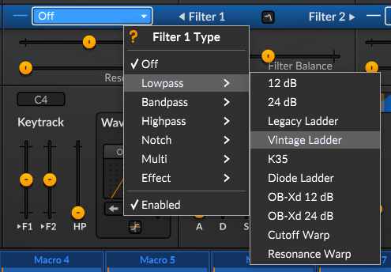

* Configura los parámetros de **A-D-S-R** en **Filter EG** y **Amp EG** de la siguiente manera:

||Filter EG| Amp EG|
|--|--|--|
|A|19 ms|21ms|
|D|250 ms|250 ms|
|S|72%|70%|
|R|500 ms| 2s|

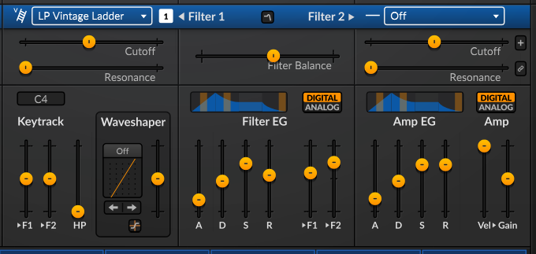

## 5. Efectos Espaciales e Ingravidez

* **Slot 1 - Modulated Delay:** Delay de tiempos desvinculados (ej. 400ms izquierdo, 550ms derecho) con **Feedback al 60%** y modulación interna.

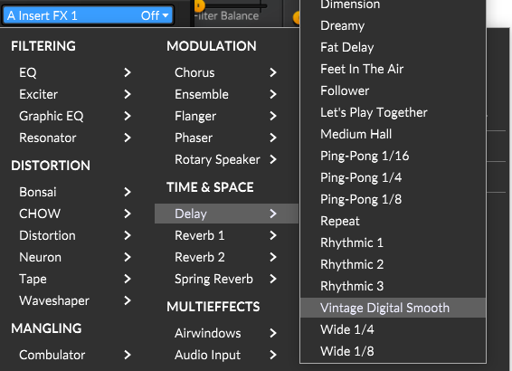

* **Slot 2 - Reverb (Nimbus):** Colocada estrictamente *después* del delay. Sube el **Size al máximo** y el **Mix entre 45% y 60%** para diluir por completo los ecos en una nube tridimensional infinita.

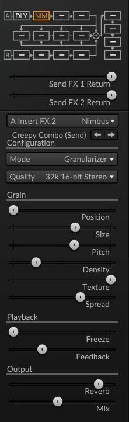

Si volumen del sonido se reduce, ajusta el **Gain** subiendo varios decibeles para aumentar la amplitud.

## Graba el Patch como Table de ondas

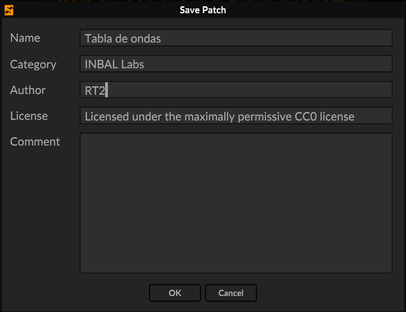

---

# :book: Referencias Bibliográficas

*   **Manual Oficial del Sintetizador:**
    Surge Synth Team. (2026). *User Manual - Surge XT*. Recuperado el 22 de octubre de 2026 de [https://github.io](https://github.io)

*   **Investigación en Síntesis de Percusión FM:**
    Hsu, J. S., & Smyth, T. (s.f.). *Percussion Synthesis using Loopback Frequency Modulation Oscillators*. University of California San Diego, Department of Music. [http://ucsd.edu](http://ucsd.edu)

*   **Guías de Diseño de Pads Ambientales en Surge XT:**
    Etherloops. (2026, 28 de abril). *How to Build a Lush Ambient Pad in Surge XT — Step-by-Step Sound Design Guide*. [https://etherloops.com](https://etherloops.com)

*   **Análisis Teórico sobre Moduladores e Inarmonía:**
    Roland Corporation. (s.f.). *Ultimate Guide: FM Synthesis*. Roland Articles. [https://roland.com](https://roland.com)

---

### Detalles Técnicos de la Documentación Citada

| Concepto Técnico | Fuente de Verificación | Aplicación Práctica |
| :--- | :--- | :--- |
| **Algoritmos FM2 y FM3** | [Surge XT Manual (Sección VCOs)](https://github.io) | Selección de motores de oscilador independientes con operadores Carrier y Modulators. |
| **Modulación Dinámica** | [Surge XT Manual (Mod Matrix)](https://github.io) | Enrutamiento de envolventes de filtro (FEG) y LFOs hacia los parámetros `M1/M2 Amount`. |
| **Ratios Armónicos (C:M)** | [Roland FM Guide](https://roland.com) | Configuración de relaciones numéricas enteras (2:1 para bajos, 5:1/7:1 para campanas). |

